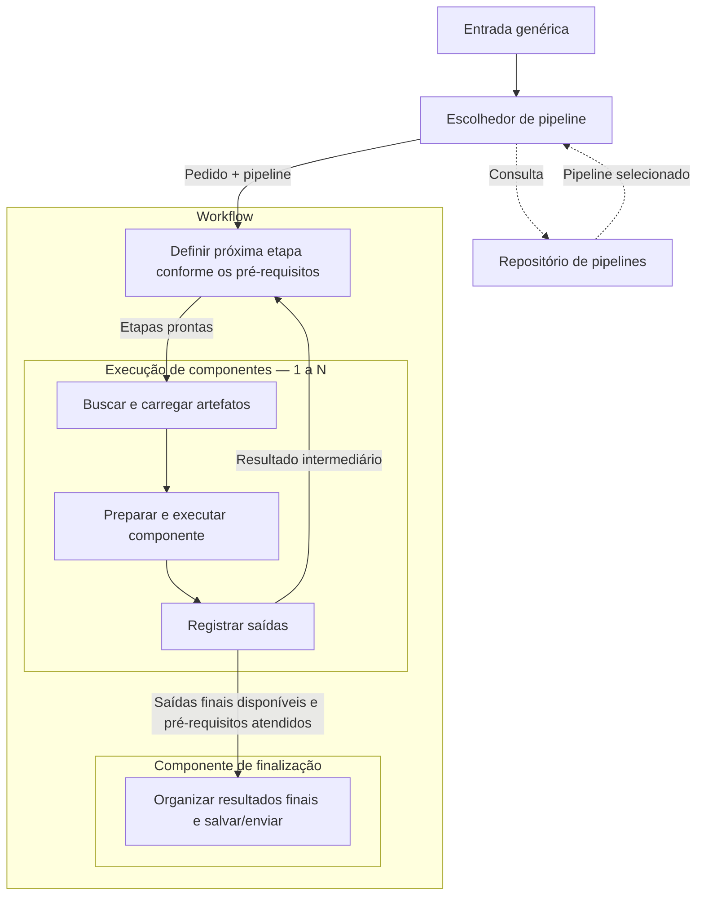
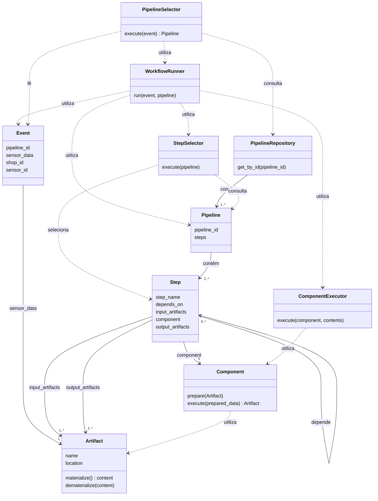
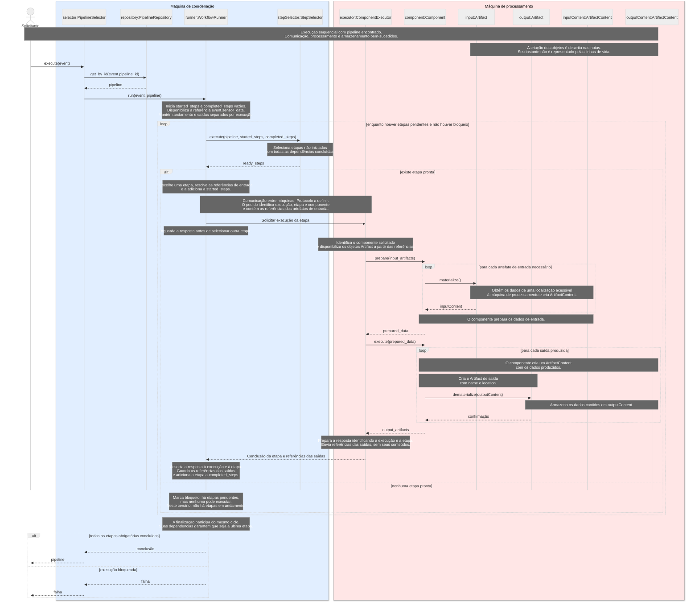

# ADR 001 — Estrutura genérica para a inferência no ciclo de MLOps

> Documento de planejamento e decisão de arquitetura, em fase de refinamento.

**Status:** Proposto
**Data da revisão:** 15/10/2026
**Escopo:** Processamento de inferência, da entrada do pedido à finalização do workflow.

## 1. Contexto

A evolução do repositório de MLOps precisa permitir que a parte de inferência atenda diferentes problemas. O caso de células sanguíneas é um ponto de partida, mas a estrutura proposta deve permitir trabalhar também com outros tipos de dados, modelos e resultados.

Os dados podem ser imagens, vídeos, tabelas ou leituras de sensores. Dependendo do problema, o processamento pode envolver um ou vários modelos e outras operações, como preparação dos dados, acompanhamento de objetos, contagem e organização dos resultados. Nem todo componente precisa executar um modelo.

A entrada do sistema é um **pedido de processamento**. Na modelagem atual, esse pedido é representado por `Event`, que informa o identificador do pipeline (`pipeline_id`), a referência ao dado (`sensor_data: Artifact`), o estabelecimento (`shop_id`) e o sensor (`sensor_id`). O conteúdo será buscado durante a execução.

Os processamentos também podem ter organizações diferentes: etapas em sequência, etapas independentes em paralelo e etapas que precisam reunir saídas anteriores. Por isso, a modelagem precisa representar as dependências entre as etapas, além das operações realizadas por cada uma.

## 2. Problema

**Como estruturar a inferência para atender diferentes entradas, modelos e saídas, mantendo uma coordenação comum entre os processamentos?**

Uma estrutura vinculada a um único caso exige adaptações na coordenação sempre que surge um processamento diferente. Isso pode misturar regras específicas do problema com responsabilidades comuns, como buscar recursos, acompanhar as etapas e registrar resultados.

A modelagem precisa resolver três necessidades:

- **Variação do processamento:** permitir mudar componentes, modelos e configurações conforme o problema.
- **Dependências entre etapas:** identificar quando uma etapa pode começar, considerando as saídas das anteriores e a possibilidade de execução em paralelo.
- **Reutilização das responsabilidades comuns:** manter um ciclo de execução que possa ser usado por diferentes componentes, incluindo o carregamento de recursos e o registro de saídas.

Também é necessário definir quando o processamento está pronto para finalizar. O término de um componente isolado não significa que todas as saídas necessárias já estejam disponíveis.

## 3. Objetivo e limites

Propor uma estrutura comum de inferência em que novos processamentos sejam definidos por pipelines e componentes compatíveis.

Quando os componentes existentes forem suficientes, um novo processamento poderá ser composto por configuração. Quando surgir uma operação ou um formato ainda não suportado, será necessário implementar um componente compatível.

Este documento trata da seleção do pipeline e da coordenação do processamento até a entrega dos resultados. Não define mudanças no treinamento, na avaliação ou na promoção dos modelos, nem escolhe uma ferramenta de orquestração ou tecnologia de armazenamento.

## 4. Decisão proposta

Separar a definição do processamento, sua coordenação e as operações sobre os dados:

- **Pipeline:** define quais componentes usar, suas configurações, suas conexões e as saídas esperadas.
- **Workflow:** coordena a execução do pipeline, acompanhando os pré-requisitos, as etapas em execução e a finalização.
- **Componente:** realiza uma tarefa específica. Pode ser reutilizado em diferentes etapas e pipelines.
- **Artefato:** é um recurso ou dado que uma etapa ou componente utiliza ou produz durante o processamento. `Artifact` guarda sua referência por meio de `name` e `location`.
- **Conteúdo do artefato:** `ArtifactContent` representa os dados efetivamente utilizados ou produzidos pelo componente. `materialize()` disponibiliza esse conteúdo, e `dematerialize(content)` o armazena. A coordenação recebe as referências dos resultados, sem precisar carregar seus conteúdos.

Uma etapa representa o uso de um componente dentro do pipeline, com suas configurações e dependências. O mesmo componente pode aparecer mais de uma vez.

A execução de cada componente segue o ciclo comum de buscar os recursos, preparar e executar a tarefa e registrar suas saídas. O registro das saídas informa o progresso ao workflow; a decisão sobre o próximo passo fica na coordenação.

A **finalização também é um componente dentro do workflow**. Ela recebe as saídas finais previstas no pipeline, organiza os resultados e os salva ou envia ao destino definido. Sua execução só é liberada quando seus pré-requisitos estiverem atendidos. O workflow é considerado concluído com sucesso depois que a finalização termina com sucesso.

A coordenação e o processamento executam em máquinas separadas. A máquina de
coordenação recebe o pedido, seleciona o pipeline e acompanha suas etapas. A máquina
de processamento executa os componentes, materializa as entradas e armazena as saídas.

A comunicação entre elas transporta pedidos de execução e respostas com referências
aos resultados. O pedido identifica a execução, a etapa e o componente e contém as
referências das entradas. A máquina de processamento obtém os conteúdos a partir de
localizações acessíveis a ela. O mecanismo de comunicação ainda será definido.

### 4.1 Diagrama de fluxo

O bloco “Execução de componente — 1 a N” representa o ciclo comum aplicado a uma ou várias etapas. As etapas podem executar em sequência ou em paralelo, conforme suas dependências e os recursos disponíveis. O workflow possui pelo menos um componente de processamento e um de finalização. A quantidade de componentes de processamento pode variar.

O retorno de resultados à coordenação permite identificar quais etapas ficaram prontas. Ele não significa repetir automaticamente todo o pipeline. Caso um pipeline precise repetir etapas, as condições de repetição e parada precisam ser definidas.

No desenho, a coordenação libera a finalização quando seus pré-requisitos estão atendidos. Os dados recebidos por esse componente são as saídas finais registradas durante o processamento.

### 4.2 Responsabilidades das caixas

| Caixa | Responsabilidade |
| --- | --- |
| Entrada genérica | Representar o Event com pipeline_id, sensor_data, shop_id e sensor_id. |
| Escolhedor de pipeline | Consultar os pipelines disponíveis e encaminhar o pedido com o pipeline selecionado. |
| Repositório de pipelines | Armazenar as definições dos componentes, configurações, conexões e saídas esperadas. |
| Workflow | Coordenar o processamento seguindo o pipeline selecionado. |
| Definir próxima etapa conforme os pré-requisitos | Identificar as etapas que podem começar, inclusive a finalização. |
| Execução de componente | Representar o ciclo comum de obtenção dos recursos, execução e registro. |
| Buscar e carregar artefatos | Obter o conteúdo de dados, modelos ou resultados anteriores por materialize(). |
| Preparar e executar componente | Organizar as entradas, aplicar as configurações e realizar a tarefa específica. |
| Registrar saídas | Armazenar os conteúdos por dematerialize(content), disponibilizar as referências das saídas e informar a conclusão à coordenação. |
| Componente de finalização do workflow | Organizar as saídas finais e salvá-las ou enviá-las ao destino definido. |

### 4.3 Diagrama de classes

O diagrama a seguir apresenta as classes, os atributos e as assinaturas da
modelagem estrutural de referência. Os pontos de alinhamento com a sequência estão
registrados na seção 6. As relações estruturais são
representadas por linhas contínuas e as dependências de uso por linhas pontilhadas.
A associação entre repositório e pipelines representa uma relação estrutural.
A dependência entre Runner e executor representa colaboração lógica e não uma
chamada local entre objetos na mesma máquina.

`Step` representa o uso de um `Component` em determinada etapa, com suas entradas,
saídas e dependências. `depends_on` referencia as etapas que precisam terminar
antes de ela começar. O componente é a operação reutilizável.

O diagrama de classes indica entradas e saídas como `1..*`. Confirmar se todas
as etapas exigem pelo menos uma entrada e saída ou se algumas podem aceitar
coleções vazias (`0..*`).

### 4.4 Diagrama de sequência

O diagrama descreve uma execução sequencial. Materialização, preparação,
processamento e armazenamento são considerados bem-sucedidos neste cenário.
Também é representado o encerramento por dependências não atendidas.

O grupo azul representa a máquina de coordenação, que executa `PipelineSelector`,
`PipelineRepository`, `WorkflowRunner` e `StepSelector`.

O grupo vermelho representa a máquina de processamento, que executa
`ComponentExecutor`, `Component` e as operações de `Artifact`, além de manipular
os dados de `ArtifactContent`. Embora Artifact guarde referências leves, seus
métodos `materialize()` e `dematerialize(content)` realizam operações potencialmente
pesadas de obtenção e armazenamento dos dados.

A coordenação mantém e transmite referências dos artefatos, como nome e localização,
sem materializar seus conteúdos. Os objetos Python não são compartilhados
automaticamente entre as máquinas: as informações precisam ser representadas nas
mensagens e interpretadas no destino.

As cores identificam as máquinas e suas responsabilidades. Neste cenário sequencial,
a coordenação aguarda a resposta antes de selecionar outra etapa. Essa espera não
escolhe antecipadamente API ou fila. Falhas de comunicação, recuperação e execução
paralela ainda não estão representadas.

`inputContent` e `outputContent` são objetos da mesma classe `ArtifactContent`.
A criação dos objetos está descrita nas notas, sem representar o instante exato
nas linhas de vida.

1. O solicitante envia o Event ao PipelineSelector.
2. O seletor consulta o PipelineRepository pelo pipeline_id e encaminha Event e
   Pipeline ao WorkflowRunner.
3. O Runner inicia started_steps e completed_steps vazios para esta execução e
   disponibiliza event.sensor_data.
4. O StepSelector recebe o pipeline e o andamento e seleciona etapas não iniciadas
   cujas dependências estejam concluídas.
5. O Runner escolhe uma etapa pronta, resolve as referências de entrada e a marca
   como iniciada. Envia o pedido à máquina de processamento e aguarda a resposta.
6. Na máquina de processamento, o executor identifica o componente e interpreta
   as referências recebidas. Chama prepare(input_artifacts). O componente obtém os
   conteúdos por materialize(), recebendo objetos ArtifactContent, e prepara os dados.
7. O executor chama execute(prepared_data). Para cada saída, o componente cria o
   ArtifactContent e sua referência Artifact e armazena os dados por dematerialize().
8. O executor responde pela rede com a conclusão e as referências das saídas,
   identificando a execução e a etapa. O Runner associa a resposta ao pedido e
   adiciona a etapa a completed_steps depois do sucesso das operações.
9. O Runner consulta novamente o seletor. O ciclo continua até concluir todas as
   etapas obrigatórias ou identificar etapas pendentes sem nenhuma pronta.
10. A finalização executa pelo mesmo ciclo, necessariamente por último. No sucesso,
    o Runner informa a conclusão e o seletor devolve Pipeline ao solicitante.
    Se houver bloqueio, a falha é repassada ao solicitante.

## 5. Consequências esperadas

A separação permite reutilizar componentes e manter a mesma coordenação para diferentes pipelines. Também torna explícito o que cada etapa precisa receber antes de começar.

A separação física permite dedicar recursos distintos à coordenação e ao processamento,
mas acrescenta comunicação de rede e a necessidade de identificar pedidos e respostas.

Em contrapartida, será necessário definir entradas e saídas compatíveis entre componentes, acompanhar o estado de cada execução e tratar falhas. Quando não houver etapas prontas, a coordenação precisará distinguir entre aguardar uma etapa em execução, finalizar ou identificar uma dependência que não pode ser atendida.

## 6. Pontos de alinhamento e decisões pendentes

Os seguintes contratos e escolhas precisam ser alinhados durante a implementação:

- O diagrama de classes usa `ComponentExecutor.execute(component, contents)`.
  Definir sua assinatura local e o contrato remoto pelo qual o Runner solicita a
  execução usando identificação do componente e referências de entrada.
- A classe Component apresenta entrada e retorno no singular (`Artifact`), enquanto
  a sequência percorre coleções de entradas e saídas. Confirmar as multiplicidades.
- A sequência explicita `StepSelector.execute(pipeline, started_steps, completed_steps)`.
  O diagrama de classes ainda apresenta `execute(pipeline)` e precisa refletir esse contrato.
- As dependências de execução não definem, sozinhas, qual saída alimenta cada entrada.
  Falta detalhar essa ligação.
- O retorno Pipeline ao solicitante foi mantido. A alternativa de devolver artefatos
  finais ou uma confirmação ainda depende de decisão.
- A sequência inclui `ArtifactContent` como conteúdo separado de `Artifact`.
  O diagrama de classes de referência ainda precisa incorporar essa classe e explicitar
  seu uso no retorno de `materialize()` e no parâmetro de `dematerialize(content)`.

- Definir o mecanismo de comunicação entre as máquinas, como API ou fila.
- Definir o formato do pedido remoto e da resposta, incluindo identificação da
  execução e da etapa, indicação de sucesso ou falha e referências dos artefatos.
- Garantir que as localizações dos artefatos sejam acessíveis à máquina de processamento.
- Definir o tratamento de indisponibilidade, tempo de espera e eventual repetição de
  pedidos, evitando processamento duplicado.

O diagrama de sequência registra saídas por execução. Isso não deve ser entendido
como autorização para alterar objetos Step compartilhados por pedidos simultâneos.
O isolamento dos resultados será detalhado na implementação.
