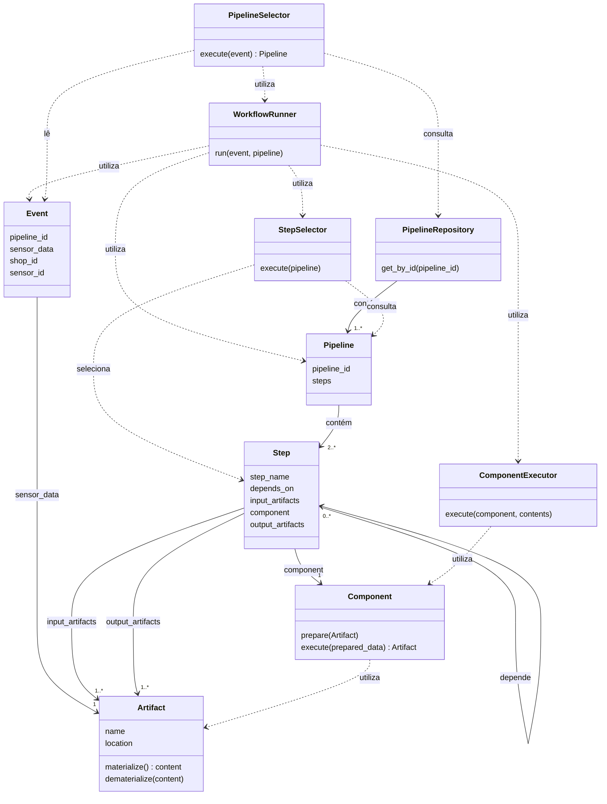

# Modelo de classes (ADR 001)

> **Origem:** `docs/diagrams/02-class-diagram.mmd` (commit `6a30f8b`), migrado em 18/11/2026 sem alterar o Mermaid. Representa a arquitetura **proposta** no [ADR 001](../adr/001-workflow-architecture.md); o orquestrador **não está implementado** (`domain.py` só tem esqueletos). Para o fluxo realmente implementado, veja [pipeline atual](current-pipeline.md).

