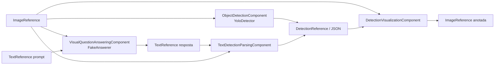
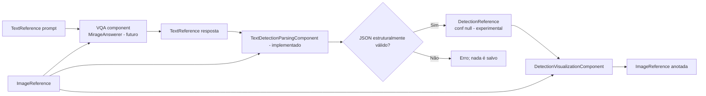

# Diagramas do ADR 001

| Arquivo | Finalidade | Situação |
|---|---|---|
| [Fluxo do workflow](workflow-flow.md) (antes `01-flow.mmd`) | Seleção de pipeline, execução das etapas e finalização | Arquitetura proposta; orquestrador não implementado |
| [Modelo de classes](class-model.md) (antes `02-class-diagram.mmd`) | Entidades e contratos | **Desatualizado.** Mostra um `Artifact` único, sem `ArtifactContent` nem os componentes reais |
| [Sequência de execução](execution-sequence.md) (antes `03-sequence-diagram.mmd`) | Sequência prevista | Já separa `ArtifactContent`; o orquestrador não foi implementado |

Esses diagramas ainda não foram alterados; em 18/11/2026 só foram movidos de `docs/diagrams/*.mmd` para documentos `Diagram`, com o Mermaid idêntico. Atualizá-los está no [roadmap](../plans/2026-11-17-plan-mirage-integration.md).

## Fluxo implementado e verificado (17/11/2026)

O VQA e o parser foram verificados só com `FakeAnswerer`.

## Fluxo-alvo do desafio MIRAGE (planejado, não implementado)

- **Validade estrutural não é precisão espacial**: a precisão só será conhecida medindo com inferência real.
- **Alternativa para as caixas:** um detector guiado por texto (OWLv2, Grounding DINO) implementando `ObjectDetector`. Ele se encaixaria no primeiro fluxo sem mudar nenhuma interface.
