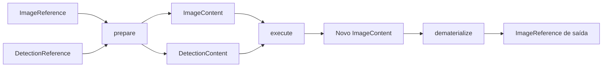

# Caminho dos dados



- **Referência (`Reference`)**: aponta para um artefato; inclui `name` e `location`.
- **Materialização**: `reference.materialize()` carrega/valida e cria um `Content`.
- **Conteúdo (`Content`)**: objeto tipado representando dados na memória.
- **Preparação**: o componente converte referências em conteúdos prontos para processamento.
- **Execução**: recebe o retorno do `prepare()`, transforma-o e gera conteúdo de saída.
- **Desmaterialização**: `content.dematerialize(reference)` salva no destino.
- **Saída do componente**: lista de `ArtifactReference` para consumo posterior.

## Exemplo lógico

```python
prepared = component.prepare([image_reference, detection_reference])
output_refs = component.execute(prepared)
```

A composição é independente do detector que produziu as detecções. O objetivo é que **a fronteira entre componentes use referências de artefatos**, enquanto o processamento interno opere sobre conteúdos materializados.

## Cuidados

- Não extrair `.data` no `prepare()`: a convenção foi aplicada no visualizador e no VQA em 17/11/2026. `ObjectDetectionComponent` ainda retorna `np.ndarray`; veja [contratos](contracts.md).
- Não sobrescrever a imagem original: trabalhar com `image_content.data.copy()`.
- Preservar distinção entre imagem original e imagem anotada por referência de saída diferente.
- Não confundir estrutura Pydantic válida com coordenadas semanticamente corretas.
